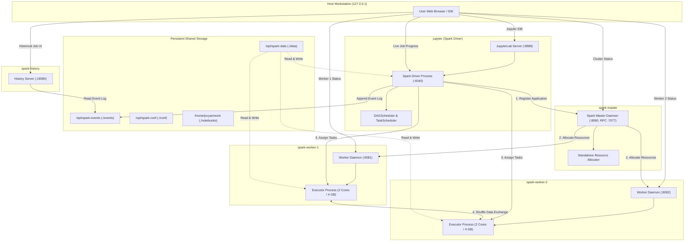

# Apache Spark 4.2.1 Distributed Learning & Engineering Lab

> **A complete, production-grade Apache Spark 4.2.1 learning curriculum, practical engineering laboratory, architecture reference, performance optimization handbook, and technical interview preparation suite — fully integrated into a self-contained Docker standalone cluster.**

---

## 1. Project Introduction

### What is Apache Spark Learning Lab?
The **Apache Spark Learning Lab** is an interactive, fully configured, multi-node distributed engineering environment designed to take learners from absolute zero to advanced production-level Apache Spark mastery.

Instead of running toy snippets in single-threaded Python scripts or disconnected cloud sandboxes, this repository provides a real distributed Apache Spark cluster running in Docker. You interact with the cluster through 82 Jupyter notebooks: 76 core curriculum notebooks, four end-to-end business case studies, and two supplementary quickstarts. Run distributed queries across independent worker containers, inspect memory spills and shuffle files on disk, analyze stage DAGs in the live Spark Web UI, and review completed jobs in the Spark History Server.

### Why Does This Project Exist?
Most Apache Spark tutorials suffer from three fundamental problems:
1. **The"Hello World"Trap**: They explain basic DataFrame syntax (`df.filter()`, `df.groupBy()`) without explaining how the execution engine physically executes the code across worker nodes.
2. **Abstract Theory Without Observable Mechanics**: Learners read about"shuffles","data skew", and"memory spills", but never see an actual shuffle partition hash bucket on disk or inspect an executor Garbage Collection pause in a live Web UI.
3. **Environment Frustration**: Setting up Apache Spark, Java versions, Scala runtimes, Python virtual environments, and history logging locally is notoriously fragile and prevents learners from focusing on data engineering concepts.

This project solves these challenges by providing a pre-configured, production-aligned distributed cluster that starts with a single command (`docker compose up -d`) and includes reproducible, verified hands-on engineering labs.

### Who is This For?
- **Data Engineers**: Looking to master Catalyst query optimization, join strategies, memory tuning, shuffle minimization, data skew mitigation, and Structured Streaming.
- **Software Engineers & Distributed Systems Enthusiasts**: Looking to understand how distributed master-worker architectures, consensus, RPCs, task scheduling, and fault tolerance operate in practice.
- **Data Scientists & Analysts**: Transitioning from single-node tools (Pandas, DuckDB) to large-scale distributed computing with PySpark.
- **Technical Candidates**: Preparing for senior and staff-level Data Engineering technical interviews with 158 verified, in-depth architectural questions.

---

## 2. Project Goals

By completing the curriculum and experiments in this repository, you will master:

- **Distributed Computing Primitives**: Partitioning, network serialization, memory boundaries, and the master-worker paradigm.
- **Resilient Distributed Datasets (RDD)**: Immutable distributed collections, transformations vs. actions, narrow vs. wide dependencies, lineage graphs, and persistence levels.
- **DataFrames and Spark SQL**: Declarative APIs, type schemas, window aggregations, complex nested types, and high-performance vectorized PySpark UDFs.
- **The Spark Execution Engine**: Lazy evaluation, DAG creation, DAGScheduler, TaskScheduler, Jobs, Stages, and Tasks.
- **Partitioning and Shuffle Architecture**: Repartition vs. coalesce, hash and range partitioners, sort shuffle service, shuffle disk spilling, and data skew mitigation.
- **Unified Memory Management**: Execution memory vs. storage memory, dynamic eviction, off-heap Tungsten allocation, and garbage collection tuning.
- **Catalyst Optimizer Internals**: Analysis, logical optimization, physical planning, cost-based optimization (CBO), and Whole-Stage Code Generation.
- **Structured Streaming**: Micro-batch processing, watermarking, stateful aggregations, trigger semantics, check-pointing, and fault-tolerant end-to-end delivery.
- **Performance Engineering**: Profiling queries using `explain(extended)`, reading Spark Web UI stages, identifying straggling tasks, and eliminating shuffles.
- **Fault Tolerance Mechanics**: Lineage replay, executor loss recovery, task speculative retries, and resilient RDD checkpoints.
- **Cluster Deployment Modes**: Client vs. cluster execution modes, Spark on YARN, Spark on Kubernetes, and Spark Connect.
- **End-to-End Production Pipelines**: Building complete batch ETL, large-scale retail analytics, data quality validation, and real-time streaming architectures.

---

## 3. Technology Stack

Every component in this repository uses verified, production-grade versions:

| Component | Exact Version | Configuration Details |
| :--- | :--- | :--- |
| **Apache Spark** | `4.2.1` | Standalone Cluster Mode with event logging enabled |
| **PySpark** | `4.2.1` | Python API with Py4J gateway |
| **Python** | `3.13` | Matched across Driver and Worker images to prevent UDF serialization mismatches |
| **Java (JVM)** | OpenJDK `21` | Eclipse Temurin 21 JRE Jammy |
| **Scala** | `2.13` | Internal Spark runtime compilation target |
| **Docker** | Engine `24.0+` | Multi-container bridge network |
| **Docker Compose** | Compose `v2+` | Declarative service orchestration with healthchecks |
| **JupyterLab** | `4.0+` | Interactive Driver environment with PySpark kernel |
| **Spark History Server** | `4.2.1` | Reads structured event logs from shared persistent volume |
| **Data Engine Libraries**| `pyarrow 25.0`, `pandas 2.3`, `numpy 2.5` | Fast columnar serialization and vectorized computation |

---

## 4. Architecture Overview

The learning lab runs as a private, distributed 5-container cluster connected via an isolated Docker bridge network (`spark-net`).

### Architecture Diagram



### Container Services & Network Endpoints

| Container Name | Service Role | CPU / Memory Capacity | Internal Port | Host Port Binding |
| :--- | :--- | :--- | :--- | :--- |
| **`spark-master`** | Cluster Master & Scheduler | 1 GB Daemon Memory | `7077` (RPC), `8080` (Web) | `127.0.0.1:7077`, `127.0.0.1:8080` |
| **`spark-worker-1`** | Worker Daemon & Executor Pool | 2 Cores, 4 GiB Executor RAM | `8081` (Web) | `127.0.0.1:8081` |
| **`spark-worker-2`** | Worker Daemon & Executor Pool | 2 Cores, 4 GiB Executor RAM | `8081` (Web) | `127.0.0.1:8082` |
| **`spark-history`** | Persistent Event Log Viewer | 1 GB Daemon Memory | `18080` (Web) | `127.0.0.1:18080` |
| **`jupyter`** | Driver Process & JupyterLab | Host assigned | `8888` (Lab), `4040` (Driver) | `127.0.0.1:8888`, `127.0.0.1:4040` |

---

## 5. Architecture and Execution Flow

When you execute code in a notebook or submit a batch application, Spark carries out a precise 13-step lifecycle:

```
[Notebook Code] ──► [SparkSession] ──► [Driver RPC to Master] ──► [Master Allocates Workers]
                                                                        │
[Executors Launch] ◄────────────────────────────────────────────────────┘
       │
       ▼
[Action Called] ──► [Catalyst Logical/Physical Plan] ──► [DAGScheduler: Stages]
                                                                │
[TaskScheduler: Tasks] ◄────────────────────────────────────────┘
       │
       ▼
[Executors Run Tasks] ──► [Shuffle Exchange] ──► [Output Written to Disk]
       │
       ▼
[Event Log Written to ./events] ──► [Rendered in History Server :18080]
```

1. **Creating SparkSession**: The Driver program inside the Jupyter container initializes `SparkSession.builder.master("spark://spark-master:7077").getOrCreate()`.
2. **Creating SparkContext**: The session instantiates a `SparkContext`, starting the internal DAGScheduler, TaskScheduler, BlockManagerMaster, and the live Driver Web UI on port 4040.
3. **Connecting Driver to Spark Master**: The Driver initiates an RPC handshake with `spark://spark-master:7077`.
4. **Registering the Application**: Spark Master registers the application, assigning a unique identifier (such as `app-20261109210723-0000`).
5. **Resource Allocation**: The Master evaluates available cluster resources across `spark-worker-1` and `spark-worker-2` and schedules Executor allocations.
6. **Executor Startup**: Each Worker spawns an independent JVM running `CoarseGrainedExecutorBackend` with 2 cores and 4 GB of RAM, and connects back directly to the Driver.
7. **Building the Execution DAG**: Notebook transformations (`filter`, `select`, `groupBy`) lazily construct an unresolved logical plan, which Catalyst resolves and optimizes into an executable physical plan.
8. **Creating Jobs, Stages, and Tasks**: Invoking an action (`count`, `collect`, `write`) submits an active Job. The DAGScheduler breaks the job into Stages separated by Shuffle boundaries (Wide Dependencies).
9. **Decomposing Stages into Tasks**: Each Stage is partitioned into Tasks, where each Task processes exactly one partition of data.
10. **Distributing and Executing Tasks**: The TaskScheduler transmits serialized task descriptions across the network to worker Executors based on data locality preferences (`PROCESS_LOCAL`, `NODE_LOCAL`, `RACK_LOCAL`, `ANY`).
11. **Executing Code on Executors**: Executors run tasks using thread pools, executing Whole-Stage Codegen bytecode, streaming shuffle blocks, and writing intermediate files.
12. **Collecting or Persisting Results**: Final results are either returned to the Driver memory (`collect()`) or written out partition-by-partition to persistent storage (`/opt/spark-data/`).
13. **Generating Event Logs & History Visualization**: During execution, the Driver asynchronously writes structured event logs into `/opt/spark-events/`. When the application finishes, the Spark History Server (`http://localhost:18080`) reads these logs to render post-mortem execution graphs, task timelines, and stage breakdowns.

---

## 6. Repository Structure

```text
Spark-Docker/
├── .github/
│   ├── ISSUE_TEMPLATE/
│   │   ├── bug_report.md
│   │   └── feature_request.md
│   ├── workflows/
│   │   └── validate.yml
│   └── pull_request_template.md
├── apps/
│   ├── pi.py
│   ├── sales_report.py
│   └── wordcount.py
├── conf/
│   └── spark-defaults.conf
├── data/
│   ├── case_studies/
│   │   ├── fraud/
│   │   ├── logistics/
│   │   └── telecom/
│   ├── logs/
│   │   └── access.log
│   ├── quality/
│   │   └── orders_dirty.csv
│   ├── retail/
│   │   ├── customers.csv
│   │   ├── order_events.json
│   │   ├── orders.csv
│   │   └── products.csv
│   ├── streaming/
│   │   └── events/
│   ├── processed/
│   ├── raw/
│   ├── sample/
│   ├── generate_case_studies.py
│   ├── generate_datasets.py
│   ├── sales.csv
│   └── words.txt
├── docs/
│   ├── 00-spark-complete-guide.md
│   ├── 01-quickstart.md
│   ├── 02-running-jobs.md
│   ├── 03-jupyter.md
│   ├── 04-operations.md
│   ├── 05-troubleshooting.md
│   ├── AUDIT_AND_IMPROVEMENT_PLAN.md
│   ├── BUSINESS_CONTEXT.md
│   ├── CASE_STUDIES.md
│   ├── COMMON_MISTAKES.md
│   ├── EXPERIMENTS_GUIDE.md
│   ├── GLOSSARY.md
│   ├── INTERVIEW_PREPARATION.md
│   ├── LEARNING_ROADMAP.md
│   ├── NOTEBOOK_TEMPLATE.md
│   ├── PRIORITY_GUIDE.md
│   ├── PRODUCTION_CHECKLIST.md
│   ├── SPARK_ARCHITECTURE.md
│   ├── TOPIC_INDEX.md
│   └── USE_CASES.md
├── events/
│   └── .gitkeep
├── notebooks/
│   ├── 00_environment_and_spark_setup/
│   │   └── 00_spark_environment.ipynb
│   ├── 01_spark_fundamentals/
│   │   ├── 01_introduction_to_spark.ipynb
│   │   ├── 02_spark_architecture.ipynb
│   │   ├── 03_spark_session_and_spark_context.ipynb
│   │   └── 04_spark_cluster_execution.ipynb
│   ├── 02_rdd/
│   │   ├── 01_rdd_fundamentals.ipynb
│   │   ├── 02_rdd_transformations_and_actions.ipynb
│   │   ├── 03_rdd_partitions.ipynb
│   │   ├── 04_rdd_dependencies_and_lineage.ipynb
│   │   └── 05_rdd_caching_and_persistence.ipynb
│   ├── 03_dataframe_and_spark_sql/
│   │   ├── 01_dataframe_fundamentals.ipynb
│   │   ├── 02_schemas_and_data_types.ipynb
│   │   ├── 03_dataframe_transformations.ipynb
│   │   ├── 04_spark_sql.ipynb
│   │   ├── 05_joins_and_aggregations.ipynb
│   │   ├── 06_window_functions.ipynb
│   │   ├── 07_nulls_and_data_quality.ipynb
│   │   └── 08_udfs_and_pandas_udfs.ipynb
│   ├── 04_execution_engine/
│   │   ├── 01_lazy_evaluation.ipynb
│   │   ├── 02_dag_and_execution_plans.ipynb
│   │   ├── 03_dag_scheduler.ipynb
│   │   ├── 04_task_scheduler.ipynb
│   │   ├── 05_jobs_stages_and_tasks.ipynb
│   │   ├── 06_narrow_and_wide_transformations.ipynb
│   │   └── 07_dependencies_and_stage_boundaries.ipynb
│   ├── 05_partitions_and_shuffle/
│   │   ├── 01_partitioning_fundamentals.ipynb
│   │   ├── 02_repartition_and_coalesce.ipynb
│   │   ├── 03_shuffle_internals.ipynb
│   │   ├── 04_shuffle_operations.ipynb
│   │   ├── 05_partitioning_strategies.ipynb
│   │   └── 06_data_skew_and_solutions.ipynb
│   ├── 06_memory_and_storage/
│   │   ├── 01_spark_memory_architecture.ipynb
│   │   ├── 02_executor_memory.ipynb
│   │   ├── 03_storage_and_execution_memory.ipynb
│   │   ├── 04_cache_and_persist.ipynb
│   │   ├── 05_spill_to_disk.ipynb
│   │   ├── 06_broadcast_variables.ipynb
│   │   └── 07_broadcast_join.ipynb
│   ├── 07_spark_sql_internals/
│   │   ├── 01_catalyst_optimizer.ipynb
│   │   ├── 02_logical_and_physical_plans.ipynb
│   │   ├── 03_tungsten_and_whole_stage_codegen.ipynb
│   │   ├── 04_join_strategies.ipynb
│   │   └── 05_adaptive_query_execution.ipynb
│   ├── 08_data_sources_and_formats/
│   │   ├── 01_csv_and_json.ipynb
│   │   ├── 02_parquet_and_orc.ipynb
│   │   ├── 03_partitioned_data_lake.ipynb
│   │   ├── 04_schema_evolution.ipynb
│   │   └── 05_reading_and_writing_data.ipynb
│   ├── 09_streaming/
│   │   ├── 01_streaming_fundamentals.ipynb
│   │   ├── 02_structured_streaming.ipynb
│   │   ├── 03_triggers_and_output_modes.ipynb
│   │   ├── 04_watermarks_and_late_data.ipynb
│   │   ├── 05_checkpoints_and_fault_tolerance.ipynb
│   │   └── 06_kafka_integration.ipynb
│   ├── 10_performance_and_optimization/
│   │   ├── 01_spark_ui_analysis.ipynb
│   │   ├── 02_explain_and_execution_plans.ipynb
│   │   ├── 03_query_optimization.ipynb
│   │   ├── 04_shuffle_optimization.ipynb
│   │   ├── 05_memory_optimization.ipynb
│   │   ├── 06_data_skew_optimization.ipynb
│   │   └── 07_performance_benchmarking.ipynb
│   ├── 11_fault_tolerance_and_reliability/
│   │   ├── 01_lineage_and_recomputation.ipynb
│   │   ├── 02_executor_failure.ipynb
│   │   ├── 03_task_retries.ipynb
│   │   ├── 04_checkpointing.ipynb
│   │   └── 05_fault_tolerance_experiments.ipynb
│   ├── 12_advanced_topics/
│   │   ├── 01_spark_on_yarn.ipynb
│   │   ├── 02_spark_on_kubernetes.ipynb
│   │   ├── 03_cluster_vs_client_mode.ipynb
│   │   ├── 04_resource_allocation.ipynb
│   │   ├── 05_spark_connect.ipynb
│   │   └── 06_pyspark_internals.ipynb
│   ├── 13_end_to_end_projects/
│   │   ├── 01_batch_etl_pipeline.ipynb
│   │   ├── 02_large_scale_sales_analytics.ipynb
│   │   ├── 03_data_quality_pipeline.ipynb
│   │   └── 04_streaming_analytics_pipeline.ipynb
│   └── 14_business_case_studies/
│       ├── 01_ecommerce_analytics.ipynb
│       ├── 02_telecom_network_analytics.ipynb
│       ├── 03_financial_fraud_patterns.ipynb
│       └── 04_logistics_delivery_analytics.ipynb
├── scripts/
│   ├── validate_notebooks.py
│   ├── check_links.py
│   ├── generate_case_studies.py
│   ├── generate_navigation_docs.py
│   ├── curriculum_metadata.py
│   ├── remove_emojis.py
│   ├── nb_utils.py
│   └── gen_*.py
├── .dockerignore
├── .env.example
├── .gitignore
├── CODE_OF_CONDUCT.md
├── CONTRIBUTING.md
├── docker-compose.yml
├── Dockerfile.spark
├── LICENSE
├── Makefile
├── README.md
└── requirements.txt
```

---

## 7. Complete Curriculum Roadmap (82 Notebooks)

The curriculum is structured into 15 progressive modules: 76 core topic notebooks, four
end-to-end business case studies, and two supplementary quickstart notebooks. Core topic
notebooks follow the A–L structure: objectives, motivation, concepts, internals,
implementation, use cases, business value, production guidance, trade-offs, experiments,
exercises, and summary.

| Module | Directory | Topics Covered | Notebook Count |
| :--- | :--- | :--- | :--- |
| **00** | `00_environment_and_spark_setup/` | Standalone cluster verification, driver-worker RPC, volume validation | 1 |
| **01** | `01_spark_fundamentals/` | Distributed computing basics, cluster architecture, SparkSession vs SparkContext, cluster execution | 4 |
| **02** | `02_rdd/` | RDD primitives, transformations vs actions, partitions, lineage graphs, caching and storage levels | 5 |
| **03** | `03_dataframe_and_spark_sql/` | DataFrame APIs, StructType schemas, aggregations, window functions, null safety, vectorized Pandas UDFs | 8 |
| **04** | `04_execution_engine/` | Lazy evaluation, DAG creation, DAGScheduler, TaskScheduler, Jobs/Stages/Tasks, narrow vs wide dependencies | 7 |
| **05** | `05_partitions_and_shuffle/` | Repartition vs coalesce, hash partitioning, shuffle service, spill metrics, data skew salting | 6 |
| **06** | `06_memory_and_storage/` | Unified memory manager, execution vs storage eviction, off-heap memory, disk spill, broadcast variables and joins | 7 |
| **07** | `07_spark_sql_internals/` | Catalyst optimizer rules, logical vs physical plans, Tungsten whole-stage codegen, join selection, AQE | 5 |
| **08** | `08_data_sources_and_formats/` | CSV/JSON readers, Parquet/ORC columnar formats, data lake directory partitioning, schema evolution | 5 |
| **09** | `09_streaming/` | Structured Streaming engine, streaming queries, trigger intervals, watermarking late data, checkpoints, Kafka | 6 |
| **10** | `10_performance_and_optimization/` | Reading Spark UI metrics, `explain()` trees, shuffle tuning, memory tuning, skew mitigation, benchmarking | 7 |
| **11** | `11_fault_tolerance_and_reliability/` | Lineage recomputation, executor crash simulation, task retry mechanisms, RDD checkpoints, chaos experiments | 5 |
| **12** | `12_advanced_topics/` | Spark on YARN, Spark on Kubernetes, client vs cluster modes, dynamic resource allocation, Spark Connect | 6 |
| **13** | `13_end_to_end_projects/` | Batch ETL pipeline, large-scale sales analytics, automated data quality framework, real-time streaming pipeline | 4 |
| **14** | `14_business_case_studies/` | E-commerce revenue and retention, telecom network quality, financial fraud patterns, logistics delivery performance | 4 |
| **Total** | | **76 core topics + 4 case studies = 80 curriculum notebooks** | **80** |

The two root-level notebooks (`00_spark_quickstart.ipynb` and `01_spark.ipynb`) are
supplementary: a fast smoke test and a scratch pad. They are not counted in the 80
curriculum notebooks. Total learning notebooks: 82. An additional reusable template lives
in `notebooks/templates/00_topic_template.ipynb`.

---

## 8. Comprehensive Documentation Suite

The `docs/` directory provides comprehensive, production-grade technical references:

| Document | Description |
| :--- | :--- |
| **[`docs/CASE_STUDIES.md`](docs/CASE_STUDIES.md)** | Index and engineering notes for the four runnable case studies: business context, schemas, architecture, expected results, production guidance, and caveats. |
| **[`docs/BUSINESS_CONTEXT.md`](docs/BUSINESS_CONTEXT.md)** | How Spark fits into a modern data stack: batch vs streaming, architecture patterns, economics, quality, reliability, security, and when another tool is a better fit. |
| **[`docs/USE_CASES.md`](docs/USE_CASES.md)** | Topic-specific real-world scenarios for every core notebook, with business decisions, Spark mechanisms, and trade-offs. |
| **[`docs/TOPIC_INDEX.md`](docs/TOPIC_INDEX.md)** | Navigation index with priority, effort, prerequisites, experiments, and role paths for all 76 core topics. |
| **[`docs/LEARNING_ROADMAP.md`](docs/LEARNING_ROADMAP.md)** | Structured 12-week learning path from novice to senior distributed data engineer, including weekly milestones and self-assessment criteria. |
| **[`docs/PRIORITY_GUIDE.md`](docs/PRIORITY_GUIDE.md)** | Engineering priority matrix ranking Spark concepts by daily production relevance, interview frequency, and mastery difficulty. |
| **[`docs/SPARK_ARCHITECTURE.md`](docs/SPARK_ARCHITECTURE.md)** | Exhaustive architectural manual detailing memory layouts, execution lifecycles, network RPCs, shuffle mechanics, and internal schedulers. |
| **[`docs/INTERVIEW_PREPARATION.md`](docs/INTERVIEW_PREPARATION.md)** | Technical interview questions categorized across Junior, Mid, Senior, and Staff engineering levels with rigorous model answers. |
| **[`docs/COMMON_MISTAKES.md`](docs/COMMON_MISTAKES.md)** | Catalog of classic production antipatterns (`count()` abuse, small files, accidental shuffles, Cartesian joins) with code before/after fixes. |
| **[`docs/GLOSSARY.md`](docs/GLOSSARY.md)** | Precisely defined terms covering Spark internals, distributed systems theory, and JVM memory mechanics. |
| **[`docs/EXPERIMENTS_GUIDE.md`](docs/EXPERIMENTS_GUIDE.md)** | Catalog of empirical experiments designed to trigger memory spills, task retries, data skew, and shuffle bottlenecks under controlled conditions. |
| **[`docs/PRODUCTION_CHECKLIST.md`](docs/PRODUCTION_CHECKLIST.md)** | Production deployment readiness checklist covering cluster sizing, storage layouts, shuffle configs, memory ratios, and streaming operations. |
| **[`docs/NOTEBOOK_TEMPLATE.md`](docs/NOTEBOOK_TEMPLATE.md)** | The A–L notebook structure and quality checklist used by the curriculum. |

---

## 9. Available Datasets (`/opt/spark-data/`)

The `./data` directory is mounted into all cluster containers at `/opt/spark-data/`:

| Dataset Path | Format | Records / Size | Description |
| :--- | :--- | :--- | :--- |
| `/opt/spark-data/retail/orders.csv` | CSV | 60,001 rows (3.8 MB) | E-commerce orders: `order_id`, `customer_id`, `product_id`, `order_ts`, `quantity`, `unit_price`, `discount`, `status`, `channel` |
| `/opt/spark-data/retail/customers.csv` | CSV | 8,001 rows (665 KB) | Customer demographics: `customer_id`, `first_name`, `last_name`, `email`, `country`, `region`, `segment`, `loyalty_tier` |
| `/opt/spark-data/retail/products.csv` | CSV | 301 rows (19 KB) | Catalog items: `product_id`, `product_name`, `category`, `list_price`, `cost`, `launch_date`, `active` |
| `/opt/spark-data/retail/order_events.json` | JSON | 3,000 docs (1.1 MB) | Nested order events with nested StructTypes and item ArrayTypes for complex JSON query labs |
| `/opt/spark-data/quality/orders_dirty.csv` | CSV | 5,151 rows (325 KB) | Intentionally malformed records: null IDs, negative prices, future dates, and invalid categoricals |
| `/opt/spark-data/logs/access.log` | Text | 20,000 lines (2.8 MB) | Real Apache web server access logs for regex parsing and streaming forensics |
| `/opt/spark-data/sales.csv` | CSV | 49 rows | Compact order dataset for rapid testing and quickstart demos |
| `/opt/spark-data/words.txt` | Text | 13 lines | Classic text file for distributed word-count tutorials |
| `/opt/spark-data/streaming/events/` | Text/JSON | Dynamic | File stream landing directory for structured streaming ingestion |
| `/opt/spark-data/case_studies/telecom/` | CSV | 36,008 rows | Eight towers and one week of synthetic voice, SMS, and data events |
| `/opt/spark-data/case_studies/fraud/` | CSV | 30,012 rows | Synthetic card transactions and merchants, including 600 labelled frauds |
| `/opt/spark-data/case_studies/logistics/` | CSV | 20,010 rows | Ten hubs and two months of synthetic shipments across four carriers |

Regenerate the core datasets with `python3 data/generate_datasets.py`. Regenerate the
case-study data with `python3 data/generate_case_studies.py`. Both generators are
deterministic.

---

## 10. Getting Started & Installation

### Prerequisites
- Docker Engine 24+ and Docker Compose v2+.
- 8 GB RAM minimum (16 GB recommended).
- 15 GB free disk space.
- Available ports: `7077`, `8080`, `8081`, `8082`, `8888`, `18080`, `4040`, `4041`.

### 1. Clone the Repository
```bash
git clone https://github.com/elhussienysabry/Spark-Docker.git
cd Spark-Docker
```

### 2. Optional Environment Configuration
```bash
cp .env.example .env
```
Default settings allocate 2 cores and 4 GB of RAM to each worker with timezone `Africa/Cairo` and Jupyter token `spark`.

### 3. Start the Cluster
```bash
docker compose up -d
```
Docker will build the custom `spark-local:4.2.1` image and start all 5 services.

### 4. Verify Cluster Health
```bash
docker compose ps
```
All containers should display status `Up` or `Up (healthy)`.

### 5. Open Web Interfaces
- **JupyterLab**: [http://localhost:8888/?token=spark](http://localhost:8888/?token=spark)
- **Spark Master UI**: [http://localhost:8080](http://localhost:8080)
- **Worker 1 UI**: [http://localhost:8081](http://localhost:8081)
- **Worker 2 UI**: [http://localhost:8082](http://localhost:8082)
- **Spark History Server**: [http://localhost:18080](http://localhost:18080)
- **Spark Driver UI** (while a job is running): [http://localhost:4040](http://localhost:4040)

### 6. Run Your First Notebook
Open your browser to JupyterLab, navigate to `notebooks/00_environment_and_spark_setup/00_spark_environment.ipynb`, and run all cells to verify driver-worker communication.

---

## 11. Command Line Convenience (`Makefile`)

The repository includes a `Makefile` with standard operations:

```bash
make help          # Show available make targets
make up            # Start all Docker containers in detached mode
make down          # Stop all containers (preserves notebooks and datasets)
make ps            # Check container health and port bindings
make logs          # Follow live cluster container logs
make pyspark       # Launch interactive PySpark REPL connected to the cluster
make sql           # Launch interactive Spark SQL shell
make test          # Run sample batch jobs (Pi, WordCount, Sales)
make validate      # Validate notebook JSON/AST and local Markdown links
make clean-output  # Clean generated warehouse outputs and event logs
```

---

## 12. Automated Validation

Before committing code or submitting pull requests, run the automated validation script:

```bash
python3 scripts/validate_notebooks.py
```

This validates:
- JSON structure and required notebook fields across 83 notebook files (82 learning
  notebooks plus one template).
- Abstract Syntax Tree (AST) parsing of every Python code cell, including case studies.
- Cell metadata sanity and stored error outputs.

The validator is repository-relative, so it works on a CI runner without a hard-coded
local path. Run the standalone link checker for README, docs, and notebook Markdown links:

```bash
python3 scripts/check_links.py
```

Docker Compose configuration is validated separately:

```bash
docker compose config
```

---

## 13. Contributing, Community & Governance

We welcome contributions from the distributed data engineering community. Please review our project governance documents:

- **[Contributing Guide](CONTRIBUTING.md)**: Detailed pull request guidelines, curriculum standards, and AST validation instructions.
- **[Code of Conduct](CODE_OF_CONDUCT.md)**: Contributor Covenant v2.1 standards for maintaining a welcoming and professional community.
- **[Security Policy](SECURITY.md)**: Vulnerability disclosure guidelines and container security practices.
- **[License](LICENSE)**: Licensed under the open-source MIT License.

---

## 14. License

This project is licensed under the MIT License. See the [LICENSE](LICENSE) file for complete details.

Copyright (c) 2026 Elhussieny Sabry.
